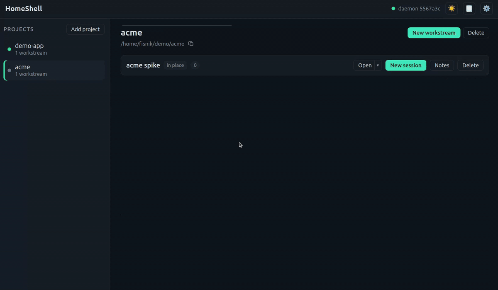

# HomeShell

HomeShell watches and drives AI coding agents across your projects. A local daemon tracks every
agent session, whether it runs on your machine or in an Eclipse Enclave container, and shows
them all in one web UI or desktop window: what each agent is doing, which ones wait for you, and
a way to answer them.



Docs: start at the [docs index](docs/README.md).

## Install

Builds are published at [download.eclipse.org/enclave/homeshell][downloads] and as
[GitHub releases](https://github.com/eclipse-enclave/homeshell/releases): `releases/` holds the
stable releases, `rolling/` the latest build of `main`. Each release's notes have the install
commands.

- **Linux (amd64):** the `.deb` or `.rpm` package (daemon and desktop app).
- **macOS 12 or later:** the `.dmg` (desktop app). The build is unsigned, so Gatekeeper blocks the
  first open; the release notes say how to allow it.
- **Anywhere else:** the `homeshell-<os>-<arch>.tar.gz` archive for your platform, used with a
  browser. Installed into a directory you own, such as `~/.local/bin`, it updates itself from
  the channel it came from. Packages and the app are updated by installing a newer one.
- **Windows:** the Linux build inside WSL ([no native build](docs/DEV.md#releases)).

To build from source, install the [toolchain](docs/DEV.md#toolchain), then

```sh
make setup           # Go modules, pnpm workspace, Playwright's Chromium
make build           # bin/homeshell, with the web UI embedded
make build-desktop   # optional: bin/homeshell-desktop (needs a system webview, see Setup in DEV.md)
```

[downloads]: https://download.eclipse.org/enclave/homeshell/

HomeShell runs the agents; it doesn't ship them. Install at least one agent CLI it knows
(Claude Code, Codex, …) on your `PATH`, or the `enclave` CLI. What each
[provider](docs/PROVIDERS.md#existing-providers) needs is listed there.

## Run

- **Browser:** run `bin/homeshell serve` and open http://127.0.0.1:8420. `make run` builds and
  serves at the same address.
- **Desktop app:** run `bin/homeshell-desktop`, or `make run-desktop` to build and open it. It
  starts the daemon, or attaches to a running one, and opens the UI in a window. From a release
  package, launch HomeShell from your app menu.

`homeshell status` shows where a daemon runs and `homeshell stop` stops it. `homeshell update`
installs a newer release, so it has nothing to fetch until the first one is published. Flags,
settings and environment variables are in
[CONFIGURATION.md](docs/CONFIGURATION.md).

## First use

1. **Add a project:** pick a directory with your code. It comes with a workstream that works in
   that folder, on the branch checked out there.
2. **Start a session** in it: pick an agent. Its state (running, waiting, idle) and a preview of
   its terminal update live.
3. **Answer it:** type into the session's input, or open it in a terminal.
4. **Work in parallel:** create more workstreams, each in a new git worktree or copy.

The words used here are defined in [CONTEXT.md](CONTEXT.md).

## Contributing

Start with [CONTRIBUTING.md](CONTRIBUTING.md) for contribution terms and the development workflow.
Changes are listed in [CHANGELOG.md](CHANGELOG.md). Community participation follows the
[Code of Conduct](CODE_OF_CONDUCT.md); report vulnerabilities privately via [SECURITY.md](SECURITY.md).

## License

HomeShell is licensed under the [MIT License](LICENSE). See [NOTICE.md](NOTICE.md) for project
and third-party notices.
