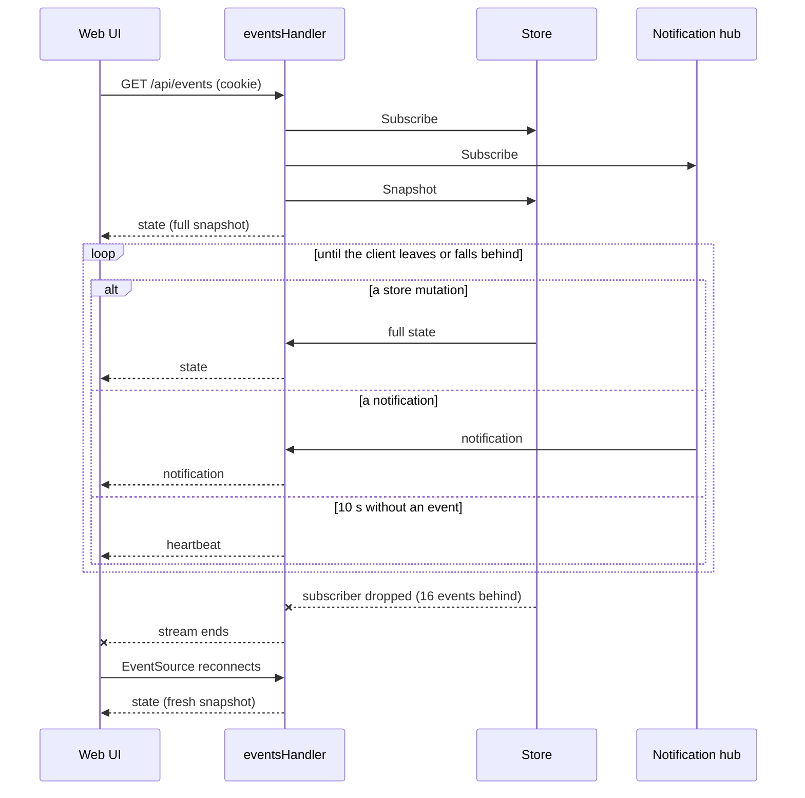

# API

The daemon's public HTTP API: how clients authenticate, the two event streams, and every
endpoint. The web UI, the desktop shell and the CLI verbs all use it; none has a private
channel. How the daemon is built behind it is in [ARCHITECTURE.md](ARCHITECTURE.md); domain
terms (project, workstream, session, open mode, …) are defined in [CONTEXT.md](../CONTEXT.md).

- **Code:** `daemon/internal/api` (see [Components](ARCHITECTURE.md#components)).
- **Contract tests:** `webapp/apps/web-e2e/src/api` (see [Principles](ARCHITECTURE.md#principles)).
- Anything outside `/api/` is the embedded web UI.

## Conventions

- **JSON** in and out. Request bodies are JSON objects; responses are JSON unless noted.
- **Full state comes from the event stream.** Most mutations answer `204` or the created row,
  and every client sees the result in the next `state` event (see [Event stream](#event-stream)).
- **Asynchronous creates answer with a placeholder.** Creating a workstream (`201`) or a session
  (`202`) and restarting a session (`202`) return the row as it stands now; the real row arrives
  through the event stream with the placeholder's ID in `placeholderId`.
- **Daemon-authored choices.** Open modes and actions arrive as data on each workstream
  (`openModes`, `actions`); a client renders them and echoes the ID back. It never builds one.
- **Unknown path or method** under `/api/` is a `404` or `405`, never the web UI.

### Errors

Errors are `{"error": "<message>"}`. The message is for people and may change; clients branch
on the status, or on `reason` where one is given.

| Status | Meaning |
|---|---|
| `400` | Malformed body or invalid value. Form validation adds `fields`: JSON pointer → message |
| `401` | Missing or wrong token (see [Authentication](#authentication)) |
| `403` | Rejected by the [origin guard](#origin-guard) |
| `404` | Project, workstream, session or catalog row not found |
| `409` | Well-formed, but the current state refuses it (a taken name, a busy workstream, …) |
| `413` | Body over the endpoint's limit |
| `501` | The provider lacks the capability, or the host has no native folder chooser |
| `503` | The provider is unavailable, or the daemon runs without the feature behind the endpoint |
| `500` | Anything else |

- Provider errors map to statuses in one place: `api.go` `writeProviderError`.
- **Removing a busy workstream** answers `409` with `"reason": "sessionsRunning"` and the
  `sessions` blocking it (`id`, `title`, `state`). A client confirms, then retries with `force`.

## Authentication

Every `/api/` request must carry the daemon's token, either way:

- **`Authorization: Bearer <token>`**: the CLI reads the token from the discovery file
  `daemon.json`; the vite dev proxy and the e2e suites inject it from
  `HOMESHELL_API_TOKEN`.
- **The `hs_api_token` cookie** (HttpOnly, `SameSite=Strict`, `Path=/`): the daemon sets it on
  the web UI document it serves, so a browser's `fetch` and `EventSource` authenticate with no
  UI code. Why: a browser cannot add a header to an `EventSource`, and the token stays out of
  JavaScript.

Rules (`auth.go` `requireToken`, `issueTokenCookie`):

- The token ([Daemon lifecycle](ARCHITECTURE.md#daemon-lifecycle)) is compared in constant time
  and never echoed. Every `hs_api_token` cookie on a request is tried, not only the
  first. Why: a page on another local port can plant a second one that would shadow the real
  cookie.
- A header that is not a usable Bearer token falls through to the cookie.
- **Cookie handout.** The cookie is set only on a `GET` document navigation (`Accept` contains
  `text/html`, `Sec-Fetch-Dest` absent or `document`) from a loopback peer with a loopback-literal
  `Host`, and never on a public bind. Why `Sec-Fetch-Dest`: `Accept` is CORS-safelisted, so a
  hostile page could otherwise fetch the token as a no-cors subresource.
- **Self-heal.** A `401` re-sets the current cookie when the request already carried a non-empty
  `hs_api_token`, came from a loopback peer, is same-origin (`Sec-Fetch-Site` absent or
  `same-origin`) and the bind is not public. Why: a restart rotates the token, and an open UI
  would otherwise stay locked out until reloaded.
- The browser does not retry an `EventSource` after a `401`, so the UI recreates a closed one
  with backoff (`webapp/apps/web/src/app/use-reconnecting-event-source.ts`).
- The token never goes in a URL. Why: query strings reach access logs. The log scrubber still
  redacts a `token` query key (`scrub.go`).

What the cookie handout accepts:

- Run the daemon on a single-user machine: on loopback the handout is unauthenticated, so any
  local process can read the token from it. Why: a browser has no credential on its first visit.
- A cookie is scoped to a host, not a port, so the browser also sends it to other servers on
  `127.0.0.1`. Do not run the daemon alongside a browser-reachable local service you do not
  trust.
- Such a page can also collect the token by navigating to the UI, which the handout serves. Why
  that navigation is not refused: a link to the UI from any other page would then load a UI whose
  every call fails.
- On a public bind (`serve --allow-public`) there is no handout and no TLS. Clients get the
  token out of band; a browser-facing deployment needs an authenticating, TLS-terminating proxy
  in front.
- Why no handout on a public bind even to a loopback peer: that peer may be the proxy, which
  would relay the token on.

## Origin guard

`guard.go` `guardLoopback` runs before authentication and answers `403` to:

- **A `Host` that is not a loopback literal** (`localhost` or any loopback IP, any port). Why: a
  DNS-rebound page arrives with its own name as `Host`. Any port is accepted so `ssh -L` and other
  loopback port-forwards keep working.
- **An `Origin` that is not a loopback `http` or `https` origin on the port the request was
  addressed to.** Why: two ports on `localhost` are the same site, so the cookie rides along on a
  request from another local port; this check is what stops it.

Also:

- A bind host that resolves to loopback but is not a literal (an `/etc/hosts` alias) would be
  rejected on every request; `serve` warns about it at startup (`api.GuardAcceptsHost`). Why not
  resolve the name: re-resolving is exactly what the rebinding defense refuses.
- On a public bind the `Host` check is skipped, and a present `Origin` must match the request's own
  host and port.
- A request without an `Origin` (a plain `GET` from a page's ``, say) passes the `Origin`
  check. That is safe because every `GET` endpoint is read-only.
- Middleware order, outermost first: request logging, origin guard, token check, routes
  (`api.Handler`).

## Request logging

- Every `/api/` response carries an `X-Request-Id` header, matching the daemon's log line for it.
- Below the `verbose` log level no bodies are logged. At `verbose`, query strings and bodies are
  logged, capped, with secret-looking fields redacted (`logging.go`, `scrub.go`).

## Event stream

`GET /api/events` is a Server-Sent Events stream of the full state (`events.go`
`eventsHandler`). Why full state and SSE: see
[Pushing state to clients](ARCHITECTURE.md#pushing-state-to-clients).

| Event | `id:` | `data:` | When |
|---|---|---|---|
| `state` | Change counter | `{"projects": [...]}` | On connect, then after every change |
| `notification` | none | A notification (below) | When an agent needs the user, or a test is sent |
| `heartbeat` | none | `{}` | After 10 s with no other event (`api.DefaultHeartbeat`) |

- **`state`** holds every project with its workstreams and sessions, with all states already
  derived ([State aggregation](ARCHITECTURE.md#state-aggregation)). The shape is the wire model
  in `daemon/internal/domain`. `GET /api/projects` returns the same document.
- **The `id` is only a counter.** The daemon ignores `Last-Event-ID`; every connection starts
  with a fresh snapshot.
- **A slow client** is dropped and its stream ends cleanly; the browser's `EventSource`
  reconnects on its own. A client too slow for a `notification` just misses it and stays
  connected. Why: a missed state leaves the client stale, but a missed alert does no harm.
- **`notification`** ([CONTEXT.md](../CONTEXT.md#agents-and-notifications)) is never replayed on reconnect. Fields:
  `id`, `kind` (`waiting`, `finished` or `test`), `title`, `body`, `sound`, `projectId`,
  `projectName`, `workstreamId`, `sessionId`, `sessionTitle`, `agent`
  (`daemon/internal/notify` `Notification`). `waiting` is a session entering waiting; `finished`
  is a busy session going idle.
- **`heartbeat`** lets the UI show itself connected without a change
  (`webapp/apps/web/src/app/use-daemon-state.ts`).

## Log stream

`GET /api/logs` streams the daemon's log records as SSE for the UI's log pane (`logs.go`).

- **`log`** events: `id:` is the record's sequence number, `data:` is
  `{seq, time, level, msg, attrs}`. `heartbeat` events as on the event stream.
- No backlog: the stream opens with a `heartbeat`, then carries whatever is logged after
  connecting. Why the heartbeat: a proxy that holds headers until the first body byte would
  leave a quiet daemon's stream looking unopened.
- What arrives follows the daemon's live log level (see `/api/config`).
- A slow client is dropped and reconnects. `503` if the daemon has no log hub.
- The streaming path must not log. Why: each streamed record would log another one, forever.

## Endpoints

Paths are under `/api`. Endpoints without a response listed answer `204` with no body.

### Daemon

| Endpoint | Request | Response |
|---|---|---|
| `GET /hello` | | `{message, version}` |
| `GET /version` | | `{channel, current, latest, updateAvailable, error?}` |
| `POST /update` | | `{updated, version}`; `updated: false` if already latest |
| `GET /config` | | `{logLevel}` |
| `PATCH /config` | `{logLevel}` | `{logLevel}` |

- **`/hello`** is the liveness probe; startup uses it to detect a running daemon.
- **`/version`** reports builds of the [release channel](../CONTEXT.md#releases): versions on
  `stable`, short commits on `rolling`. `channel` is empty for a build that never updates itself,
  which then reports its own version as `latest` and `updateAvailable: false`, without `error`.
  A failed release check also answers `updateAvailable: false` and sets `error`.
- **`/update`** sends its answer before the daemon re-executes, then the event stream drops and
  reconnects to the new binary ([Self-update](ARCHITECTURE.md#self-update)). `version` is the
  installed build. `503` with the reason when this build does not update itself, `409` with the
  manual reinstall commands when the executable is not writable for the daemon's user, `500` with
  the reason if the download or verification fails.
- **`/config`** is the live runtime configuration (today the log level); `PATCH` applies at once
  and saves the level as the startup default. Why separate from `/settings`: a stored copy of a
  live value could drift from what the daemon is doing.

### Projects

| Endpoint | Request | Response |
|---|---|---|
| `GET /projects` | | `{projects: [...]}`, the `state` event's data |
| `POST /projects` | `{path, name?}` | `201`, the project |
| `PATCH /projects/{id}` | `{name}` | |
| `DELETE /projects/{id}` | | |
| `POST /projects/{id}/refresh` | | |

- **Add.** `path` is resolved (`~` expands) and must be an existing directory; `name` defaults to
  its base name. A path already added is `409`. The project comes with its
  [default workstream](../CONTEXT.md#core-entities) already in its `workstreams`; if that cannot
  be made, the project is added without it (logged).
- **Remove** stops tracking the project. Its sessions are left running; in-flight creates and
  restarts for it are cancelled.
- **Refresh** re-detects whether the project is a git repository.
- **Untracked worktrees.** Every project has `untrackedWorktrees: [{name, branch?, path,
  sessionCount}]`, the [untracked worktrees](../CONTEXT.md#working-directory) HomeShell suggests
  adding. Derived, not stored; refreshed every `providers.refreshIntervalSec`; empty outside git.
  `sessionCount` counts the sessions there not ended, hidden until the worktree is added.

### Workstreams

Paths are under `/api/projects/{projectId}`; `{ws}` stands for `/workstreams/{workstreamId}`.

| Endpoint | Request | Response |
|---|---|---|
| `GET /workstream-providers` | | Providers that can create here (see [Providers](#providers)) |
| `POST /workstream-draft` | `{providerId, name?, config}` | `{name, config}` |
| `POST /workstreams` | `{providerId, name?, config}` | `201`, the `creating` placeholder |
| `POST /default-workstream` | | `201`, the default workstream |
| `POST /worktree-workstreams` | `{path}` | `201`, the workstream |
| `PATCH {ws}` | `{name}` | |
| `DELETE {ws}` | `{keepFiles?, force?}`, or `?force=true` | |
| `DELETE {ws}/status` | | |
| `POST {ws}/open` | | Open result |
| `POST {ws}/open-with` | `{mode}` | Open result |
| `POST {ws}/note` | | `{path, created}` |

- **Create.** `config` follows the provider's `workstreamSchema`. A blank `name` is derived.
  Invalid config is `400` with `fields`; a name already in use is `409`. A directory another
  workstream works in is invalid config. The project folder is taken while any workstream is in it
  (`inProjectFolder`), a pending or failed in-place create included; removing that one frees it.
- **Default workstream** gives the project the workstream a new one comes with: core, in place,
  named like a blank create. It is created at once, with no placeholder. `409` while the project
  folder is taken.
- **Add an untracked worktree** makes a workstream of the one at `path`, which must be one of the
  project's `untrackedWorktrees` paths, else `409`; a blank `path` is `400`. It is a `worktree`
  workstream named like the suggestion, numbered (`name-2`, …) when that name is taken, with the
  sessions hidden there. Nothing is created on disk.
- **Strategies offered.** The core provider's `strategy` property has `enum` and a parallel
  `enumNames` of display names: `in-place` "In place", `worktree` "Worktree", `copy` "Folder: a
  copy of the project". While the project folder is taken, `in-place` and its name
  are left out, and in a project outside git `default` becomes `copy`. Create still validates as
  above. Why: the form should not offer what create would refuse.
- **Strategy display.** A workstream's `strategy` is a label, not the stored value: "in place",
  "worktree", or "folder" for `strategyId: "copy"`. Clients send and compare `strategyId`.
- **In the project folder.** `inProjectFolder: true` marks the workstream whose `workingDir` is
  the project folder and an in-place create's placeholder, pending or failed, which has no
  `workingDir` yet; it is absent on every other. These are what take the folder (see Create). Why: clients group by
  it without re-deriving the daemon's rule.
- **Folder missing.** `folderMissing: true` marks a `worktree` workstream whose worktree was
  removed outside HomeShell while a session in it has not reached a terminal state. It stays
  listed with its sessions until they do, then goes on its own; a Remove takes it sooner, the busy
  guard included. Absent on every other.
- **Draft** answers what a create with the same body would derive for its blanks (name, branch,
  path) and creates nothing.
- **Remove** ([Workstream lifecycle](ARCHITECTURE.md#workstream-lifecycle)): `keepFiles` keeps
  the directory, and a worktree kept is suggested again in `untrackedWorktrees`; a busy
  workstream needs `force` (see [Errors](#errors)). A workstream already removed is `404`. One being
  removed because its worktree vanished is waited for, and the Remove answers `204`.
- **Clearing the status** discards the workstream's status message for every client. `409` for a
  failed create. Why: there the message is the only account of what went wrong.
- **Open** runs the default open mode; **open-with** runs `mode`, one of the workstream's
  `openModes` IDs.
- **Open result:** `{mode, data}`. `data` depends on the mode. For a link it is
  `{"target": "browser", "url": …}`, which the client opens in a tab.
- **Note** opens `NOTES.md` in the working directory with the desktop's default application,
  creating it first (`created`).

### Sessions

`{ws}` is as above; `{s}` stands for `{ws}/sessions/{sessionId}`.

| Endpoint | Request | Response |
|---|---|---|
| `GET {ws}/session-schemas` | | `[{providerId, label, options: [{id, label, schema}]}]` |
| `POST {ws}/sessions` | `{providerId, optionId, config}` | `202`, the `starting` placeholder |
| `POST {s}/stop` | | |
| `POST {s}/start` | | |
| `POST {s}/restart` | `{config?, fresh?}`, optional | `202`, the session |
| `GET {s}/launch-config` | | `{providerId, optionId, config, schema, continueRefusal?}` |
| `POST {s}/prompt` | `{text}` | |
| `POST {s}/key` | `{key}` | |
| `POST {s}/open` | `{mode?}` | Open result |
| `PATCH {s}` | `{title}` | |
| `DELETE {s}/title` | | |
| `DELETE {s}` | | |

- **Schemas** list the session types each session provider offers in this workstream; `schema`
  is a JSON Schema the UI renders as the create form. Read per request, so catalog edits apply
  at once.
- **Start** continues a session in a terminal state (`stopped`, `done` or `error`) where its
  provider can; the Enclave provider does so as a restart.
- **Restart** without a body reuses the last launch config; `fresh` starts a new conversation
  instead of continuing. A session with no launch config restarts with the settings its provider
  observed, if any. `409` while the session is `starting`, or for one that cannot restart.
- **Launch config** is what the session was last started with, plus the option's schema, so a
  restart form opens pre-filled. For a session with none it holds the settings its provider
  observed, if any. `continueRefusal` says why the conversation cannot be continued.
- **Ended sessions** (`done`, `stopped`; see [CONTEXT.md](../CONTEXT.md)) stay listed until removed,
  as do sessions in `error`. The session object says so in `ended`, which clients list and count
  by, and carries `endedAt` (RFC 3339) once the daemon has seen it end: set when a live session
  turns terminal, kept while it stays terminal, dropped when it runs again. A session first seen
  already terminal has it only if its provider reports when it ended. A daemon restart keeps it
  ([Persistence](ARCHITECTURE.md#persistence)).
- **Capabilities** (`capabilities: {live, takeOver, stopWarning?}`) are what a client may do with
  one session. Absent means the session is live (HomeShell sees and types into it), offers no
  take-over and needs no stop warning. Derived, never persisted. Providers' own capabilities are
  in [PROVIDERS.md](PROVIDERS.md#capabilities).
- **Prompt** sends one line of text; body at most 64 KiB (`413`).
- **Key** sends one of `up`, `down`, `left`, `right`, `enter`, `escape`, `tab`, for navigating
  an agent's menu (`provider.SessionKeys`); another key is `400`.
- **Open** `mode` defaults to `terminal`.
- **Rename** sets a title that overrides the provider's, kept across polls; body at most 4 KiB
  (`413`).
  An empty title is `400`; restoring the provider's title is `DELETE {s}/title`.
- **Remove** is unconditional: no busy check.

### Providers

| Endpoint | Request | Response |
|---|---|---|
| `GET /providers` | | `[{id, label, status, capabilities, workstreamSchema?}]` |

- `status` is `{state: "available" | "unavailable", reason?}`.
- `capabilities` are the provider's declared features plus the optional interfaces it
  implements (`startStop`, `oneOffPrompt`, `sessionStartStop`, `sessionRestart`;
  `provider.DescribedCaps`).
- `workstreamSchema` is the JSON Schema of a workstream provider's create form.

### Settings

| Endpoint | Request | Response |
|---|---|---|
| `GET /settings` | | The settings document |
| `PUT /settings` | The settings document | The stored document |

- `PUT` replaces the whole document. An omitted key takes its default, not a zero value. Why: a
  client that does not know a newer key must not turn it off.
- Invalid values are `400`; a failed write is `500`. The response may add generated IDs.
- Changing the "open with" entries updates every workstream's `openModes` through the event
  stream.
- The keys are described in [CONFIGURATION.md](CONFIGURATION.md#settings).

### Agent catalog

The agents HomeShell can launch, their launch settings and their model lists, kept in
`agents.json` (`daemon/internal/agentcatalog`). Collections of rows with IDs, so they are not
part of `/settings`.

| Endpoint | Request | Response |
|---|---|---|
| `GET /agents` | | `{agents: [...]}`, each with its `settings` |
| `POST /agents` | An agent, `id`, `binary`, `display` required | `201`, the agent |
| `PATCH /agents/{agentId}` | Fields to change | The agent |
| `DELETE /agents/{agentId}` | | |
| `POST /agent-settings` | A setting, `agent` required | `201`, the setting |
| `PATCH /agent-settings/{settingId}` | Fields to change | The setting |
| `DELETE /agent-settings/{settingId}` | | |
| `GET /agent-models` | | `{entries: [...]}` |
| `POST /agent-models` | `{agent, model}` | `201`, the entry |
| `PATCH /agent-models/{entryId}` | `{model}` | The entry |
| `DELETE /agent-models/{entryId}` | | |

- Field names are the JSON tags of `agentspec.Agent`, `agentspec.Setting` and
  `agentcatalog.Model`.
- `PATCH` keeps fields it does not mention. An agent's ID and a row's agent are fixed.
- Deleting an agent deletes its settings and models.
- `404` for a missing row, `409` for a taken ID or a duplicate field, `400` for a row the daemon
  could not act on, `503` without a catalog.
- Nothing is checked against the agent's CLI. Why: the agent is the authority on its own flags
  and models, and a wrong value fails at launch with the agent's own message.

### Host helpers

These act on the daemon's host.

| Endpoint | Request | Response |
|---|---|---|
| `GET /browse?path=&showHidden=` | | `{path, parent, entries: [{name, path, isDir}]}` |
| `POST /browse/native` | `{path?}` | `{path}` or `{cancelled: true}` |
| `POST /open-url` | `{url}` | `{opened: true}` |
| `GET /terminal-emulators` | | `{automatic, emulators: [{id, label, installed}]}` |
| `POST /notifications/test` | `{style?}` | `{style, channels}` |

- **Browse** lists the subdirectories of `path` (default `~`), sorted, hidden ones only with
  `showHidden=true`. It is the in-app folder picker.
- **Native browse** opens the host's own folder chooser and holds the request open until the
  user answers. Cancelling is `200` with `cancelled`. `501` without a chooser, and the client
  falls back to the in-app picker. `path` is only a hint.
- **Open URL** hands an `http` or `https` URL with a host to the default browser; any other
  scheme is `400`. The UI falls back to it when `window.open` is blocked. Why the scheme
  allow-list: the platform openers launch whatever application a scheme is registered to.
- Native browse and open URL are `409` on a public bind. Why: the window would open on the
  daemon's screen, not the caller's.
- **Terminal emulators** lists this platform's emulators, whether each is installed, and what the
  automatic choice resolves to. Detected per request.
- **Test notification** delivers a sample through the channels `style` selects (`none`,
  `in-app`, `native`, `both`; default the configured one), the same path a real one takes.
- Long-lived requests (native browse, the streams) work because the server bounds only header
  reads (`ReadHeaderTimeout`). Why: any whole-request timeout would cut the SSE streams.
