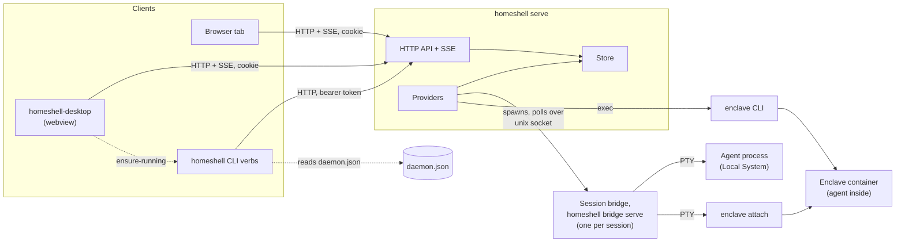
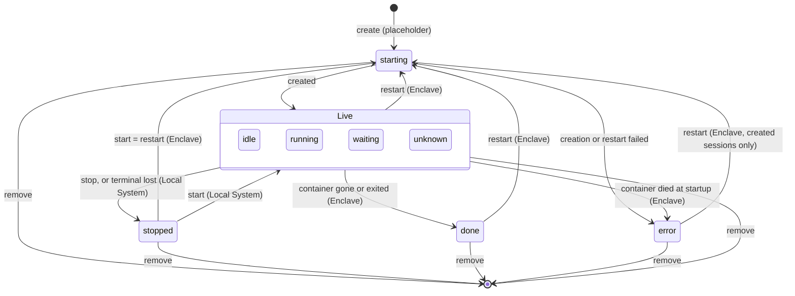
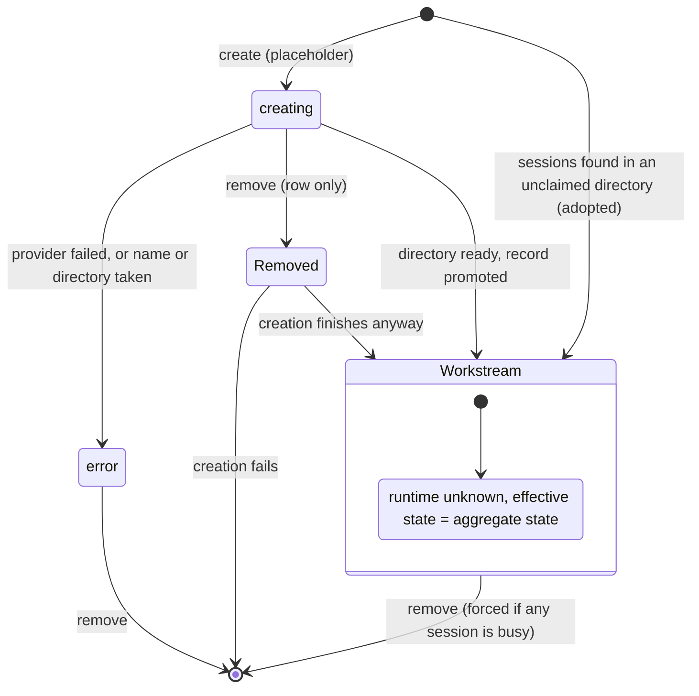
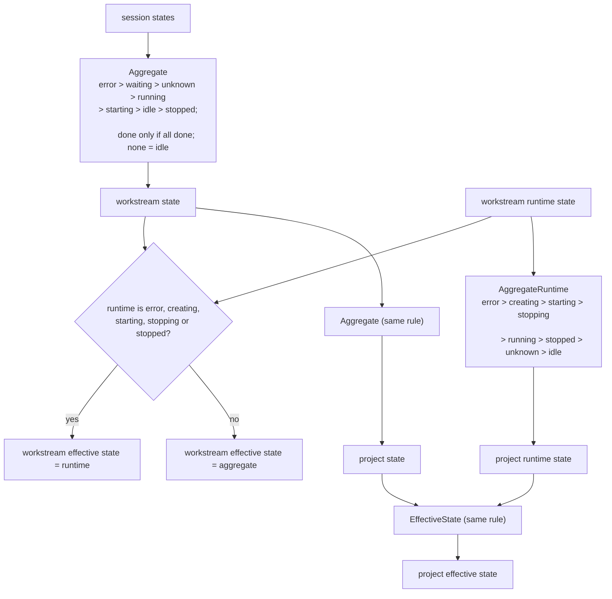
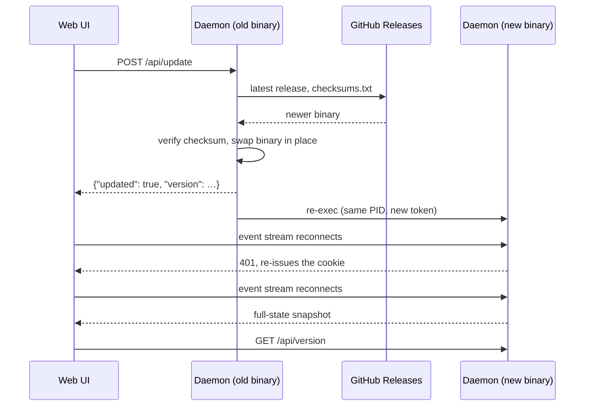

# Architecture

How HomeShell is built today: its components, the processes that run, the state model, what is
persisted, and how session state is observed. Domain terms (project, workstream, session,
session state, …) are defined in [CONTEXT.md](../CONTEXT.md) and used here without redefinition.

## Principles

- **The daemon owns all state and domain logic.** Clients (web UI, desktop shell, CLI) render
  what the daemon sends. Aggregation, capability checks and git detection are derived once, in
  the daemon; a client that re-derives a domain fact is a bug.
- **Providers do everything that acts on a workstream or session.** Optional features are
  declared as capabilities; clients gate on capabilities, never on a provider's identity.
- **The core is provider-agnostic.** Provider and strategy names travel as opaque strings, and
  HomeShell runs with partial state when a provider is unavailable.
- **One normalized state model.** Every provider maps onto the states in `daemon/internal/domain`,
  the only place they are aggregated (see [State model](#state-model)).
- **Full state, never patches.** Clients replace what they hold; no merge logic exists outside
  the daemon (see [Pushing state to clients](#pushing-state-to-clients)).
- **Hand interaction off.** HomeShell embeds no terminal or editor; it opens the user's own.
- **Observe and adopt.** Sessions may start outside HomeShell, containers die, worktrees vanish;
  providers report what exists and the daemon reconciles, rather than trusting stored metadata.
- **The public HTTP API is the contract.** Daemon behavior is e2e-tested black-box against it
  (`webapp/apps/web-e2e/src/api`), so tests, CLI and UI survive a daemon rewrite.

## Components

| Path | Role |
|---|---|
| `daemon/cmd/homeshell` | The single `homeshell` binary: daemon (`serve`) and CLI verbs |
| `daemon/internal/cli` | One file per verb, self-registering into `cli.Dispatch` |
| `daemon/internal/api` | Public HTTP API: one file per endpoint, assembled by `api.Handler` |
| `daemon/internal/store` | In-memory projects, mutation serialization, change broadcast |
| `daemon/internal/domain` | State vocabulary, aggregation, the wire model |
| `daemon/internal/provider` | Provider contracts, `Registry`, `Service`, `Reconciler` |
| `daemon/internal/provider/{local,enclave}` | The Local System and Enclave session providers |
| `daemon/internal/provider/workstream` | Filesystem strategies behind the core workstream provider |
| `daemon/internal/provider/fake` | In-memory provider for `serve -demo` |
| `daemon/internal/detect` | Session state from a rendered terminal screen |
| `daemon/internal/hostbridge` | Spawning session bridges, reading their snapshots |
| `daemon/internal/sbridge` | The [session bridge](#session-bridge): `bridge` verb, protocol, client |
| `daemon/internal/persist`, `settings` | Data directory, `state.json`, `settings.json` |
| `daemon/internal/agentcatalog`, `agentspec`, `agentmodel` | Agent catalog, launch args, model lists |
| `daemon/internal/daemonstate`, `apiclient` | Discovery file and the CLI's HTTP client |
| `daemon/internal/notify` | Notifications: in-app hub and native delivery |
| `daemon/internal/updater` | Self-update |
| `daemon/internal/webui` | The web UI, embedded into the binary |
| `webapp/apps/web` | React UI, built into `daemon/internal/webui/dist` |
| `webapp/packages/{model,components}` | UI presentation model and component library |
| `webapp/apps/web-e2e` | Playwright suites: `src/api` (no browser) and `src/ui` |
| `desktop/` | `homeshell-desktop`, a native webview window (separate Go module) |
| `packaging/` | Linux `.desktop`, macOS app bundle |

## Process topology

- **Daemon:** one per data directory, listening on loopback.
- **Clients:** short-lived CLI processes, browser tabs and the desktop window; none hold state.
- **Session bridges** run detached from the daemon (`hostbridge` `detachFromDaemon`), so agents
  keep running across a daemon restart and the daemon re-finds them by socket path.
  Why: a daemon update or crash must not kill the user's agents.
- **Enclave containers** are owned by Enclave; HomeShell drives them only through the `enclave`
  CLI (`daemon/internal/provider/enclave` `realCLI`).

## Daemon lifecycle

Entry point: `daemon/internal/cli/serve.go` `runServe`.

1. **Single instance.** Read the discovery file `daemon.json` and probe `GET /api/hello`; a live
   daemon for the same data directory makes startup fail, a stale file is overwritten.
2. **Bind.** A non-loopback address is refused unless explicitly allowed; whether the bind is
   public is read off the bound socket, not the flag.
3. **Token.** A fresh random API token per start (or a pinned one from the environment).
4. **Discovery file.** Address, PID, version and token go to `daemon.json` (mode `0600`,
   `daemon/internal/daemonstate`), removed on clean shutdown.
5. **State.** Load `state.json`, `agents.json` and `settings.json`; a corrupt file aborts start.
   Why: starting empty would silently overwrite the user's data on the next save.
6. **Providers.** Register the session providers that self-registered in `init()`, prune, then
   run one full reconcile before serving.
7. **Serve.** `/api/` is wrapped in a Host/Origin guard (`api` `guardLoopback`) and token auth
   (`api` `requireToken`: bearer header, or an HttpOnly cookie set on the served UI document).
8. **Shutdown** on SIGINT/SIGTERM: drain HTTP, stop provider background work, remove the
   discovery file. Session bridges are left running (see [Process topology](#process-topology)).

Flags, environment variables and the data directory location are in
[CONFIGURATION.md](CONFIGURATION.md); the endpoints in [API.md](API.md#endpoints).

## CLI and the client boundary

- Every verb is a peer in `daemon/internal/cli`; running the daemon is the explicit `serve` verb
  and bare `homeshell` prints usage. Dispatch is standard library only.
- **Client verbs reach the daemon only through `daemon.json` and the public HTTP API**
  (`apiclient.Discover`). They never import the daemon's domain packages; wire shapes are
  mirrored in `cli/snapshot.go`.
- Lifecycle verbs (`status`, `stop`, `ensure-running`) start from discovery: "is a daemon
  running, and where?" cannot be answered over that daemon's own API. `cli/discover.go`
  classifies it as running, stale or none.
- Only `ensure-running` starts a daemon (`cli/ensure.go` `ensureRunning`): it spawns a detached
  `homeshell serve` logging to `daemon.log` and prints the URL to load. It refuses to spawn over
  a stale file whose PID is still alive. Why: the old process may still hold the port.

## State model

All states are defined in [CONTEXT.md](../CONTEXT.md#states) and implemented in
`daemon/internal/domain`. Session state is observed and never persisted; only the structure the
user created survives a restart (see [Persistence](#persistence)).

### Session states

How a session moves between states, across providers. The live states inside the box are
derived by [agent detection](#agent-detection) on every poll, so any of them can follow any
other; only running → idle waits for the [hold](#agent-detection). A failed read gives `unknown`.

- **Placeholders.** `provider.Service.CreateSession` adds a `starting` placeholder at once and
  creates in the background; `store.PromoteEphemeralSession` swaps in the real session, or
  `store.FailEphemeralSession` turns it into `error` with the provider's message.
  A failed placeholder is never retried or restarted; the user removes it.
- **First state.** A new Local System session starts `idle`, an Enclave one `running`.
  Sessions loaded from `state.json` read `idle` until the first reconcile replaces them.
- **A screen no rule matches.** Local System reports `idle`; Enclave keeps a live container
  `running`. Why: a running container with an unrecognized screen is still working.
- **Lost terminal.** Local System reports `stopped`, not `idle`, when it cannot bring the agent
  back (see [Local System sessions](#local-system-sessions)).
  Why: `idle` would offer prompts that can only fail.
- **Restart.** `provider/restart.go` `RestartSession` refuses a session already `starting`.
  Local System has no restart; its stop and start keep the same session.
- **`done` in the web UI.** Besides the daemon's `done`, the UI shows an `idle` session the user
  has not looked at since it finished as `done`. This overlay is presentation only
  (`webapp/apps/web/src/app/use-session-attention.ts`).

### Workstream lifecycle

Runtime state is the workstream's own lifecycle. Only the creation placeholder (and the
`serve -demo` sample data, `store/seed.go`) sets it;
every real workstream reports `unknown`, which defers to its sessions (see
[State aggregation](#state-aggregation)).

- **Create.** `provider.Service.Create` validates, adds a placeholder (`creating-…` ID) and runs
  the workstream provider in the background, streaming progress into its status message.
  `store.PromoteWorkstream` replaces it with the real workstream (new ID, `PlaceholderID` links
  them).
- **Removing a placeholder still `creating`** removes only the row; the create runs on and its
  workstream appears when done (`store.PromoteWorkstream`). Why: a workstream that exists on disk
  but not in the daemon could never be removed.
- **Failed create.** The placeholder stays in `error` with the cause; it offers only removal and
  no longer reserves its name.
- **Adopt.** The reconciler makes up a workstream (`disc-…` ID) for sessions a provider reports
  in a directory no workstream claims (`provider/reconcile.go` `adoptedWorkstream`).
- **Remove.** `provider.Service.Remove` refuses while a session is busy unless forced, removes
  each session through its provider, then lets the workstream provider discard the directory.
  The reconciler never removes a workstream on its own.

### State aggregation

`domain.Project.Recompute` runs after every store mutation and derives every parent state.

- Why `error` leads: a failed create is the one state that never resolves without the user.
- Why `starting` ranks below `running`: a live agent describes the workstream better than one
  still coming up.

## Pushing state to clients

- `store.Store` holds the projection behind one mutex; every mutation is serialized and ends by
  broadcasting the **full state** to subscribers (`broadcastLocked`). A subscriber that falls
  behind is dropped and reconnects.
- `GET /api/events` (`api/events.go` `eventsHandler`) subscribes before taking its snapshot,
  so no change is lost; a duplicate is harmless because every event is complete. It sends the
  snapshot on connect, then each change, heartbeats while idle, and fire-once notifications.
- The web UI stores whatever arrived last (`webapp/apps/web/src/app/use-daemon-state.ts`) and recreates the stream on
  close, so a restarted daemon is picked up with a fresh snapshot.
- Why SSE over WebSockets: push is one-way, it is plain HTTP with the same auth, and browsers
  reconnect it on their own.

## Providers and reconciliation

- Workstream providers and session providers ([CONTEXT.md](../CONTEXT.md#providers)) meet only
  at the working directory, which the daemon uses to match sessions to workstreams.
  `provider.Registry` holds both lists; capabilities are optional Go interfaces found by type
  assertion.
- `provider.Reconciler` (`provider/reconcile.go`) runs one full pass at startup, then on demand:
  providers that watch (`Watcher`) poll on their own loop and report changes, and the reconciler
  re-asks only the provider that changed.
- **Matching.** Sessions group by cleaned working directory: existing workstreams take theirs,
  unclaimed directories get an adopted workstream. A session ID reported again supersedes the
  stored one wherever it was.
- **Retention.** A stored session nobody reported this pass survives only if its provider is
  registered and failed to report. Placeholders are always kept. Why: a transient provider error
  must not flush sessions, but a session nothing can confirm must not linger as a ghost.
- Per-project locks serialize passes; the store is re-read after discovery so concurrent creates
  survive.

## Persistence

All files live in the data directory (`persist.DefaultDir`; [how it is chosen](CONFIGURATION.md#data-directory)).

| File | Owner | Holds |
|---|---|---|
| `state.json` | `persist` | Projects, workstreams, sessions (structure only), titles, launch configs |
| `settings.json` | `settings` | User settings and the startup log level |
| `agents.json` | `agentcatalog` | The agent catalog |
| `daemon.json` | `daemonstate` | Discovery record, including the API token (`0600`) |
| `local-provider.json` | `provider/local` | Local System sessions and their bridge sockets |
| `enclave-provider.json` | `provider/enclave` | Enclave sessions, containers, last titles |
| `workstreams/` | core workstream provider | Managed copy and worktree directories (default location) |
| `daemon.log` | `cli/spawn.go` | Output of a daemon started by `ensure-running` |

- **Persisted** are the facts the user created: IDs, names, paths, providers, strategies,
  branches, working directories, provider data. **Never persisted:** session, runtime and
  effective states, previews, observation data, errors, open modes, actions, placeholders.
  Why: a persisted state would be a stale lie after a restart until the provider reports again.
- `state.json`, `settings.json`, `agents.json` and `enclave-provider.json` carry a schema
  version; `state.json` rejects any version but its own. They are written atomically: temp file,
  fsync, rename, fsync the directory (`persist.WriteFileAtomic`).
- A session's owning provider is persisted. Why: the reconciler keeps or drops a session by it,
  and any field it decides on must survive a restart.
- `persist.FileSaver` skips a write whose bytes are unchanged, so polling never rewrites the file.
  A failed write keeps the change in memory and is retried after the next reconcile.

## Agent detection

`daemon/internal/detect` implements detection ([CONTEXT.md](../CONTEXT.md#states)) as a pure
classifier: `detect.Detect` takes a snapshot (screen rows, OSC title, OSC progress) and returns
a state, whether it is confident, a title and a preview tail.

- **Rules** are Herdr's agent manifests, copied byte for byte into `detect/manifests/herdr` and
  pinned with hashes in `manifests.lock` (checked by `TestVendoredManifestProvenance`).
  `manifests/local` holds HomeShell's own overlays. All are embedded and validated at start.
- Only agents in `detect/agents.go` `runtimeScreenAgent` are detected from the screen; an agent
  with no rule set reads `unknown`.
- **Hold.** `detect.Hold` delays running → idle by 300 ms, unless the idle prompt or a blocker is
  visible or the poll interval is over 1 s. Why: a short pause mid-turn must not flap the session to idle.
- **Title.** `detect.CleanTitle` drops a leading status glyph and every control or bidi-control
  character from the OSC title. Why: the agent sets it, and it reaches terminals and notifications.
- Detection never yields `done`; providers decide that from the runtime (see
  [Session states](#session-states)). Why: a screen cannot tell "finished" from "awaiting the
  first prompt".
- Detection detail is published as the session's observation data, which is never persisted.

## Session bridge

Both session providers run each agent under a host-side session bridge
([CONTEXT.md](../CONTEXT.md#providers)), implemented in `daemon/internal/sbridge`. It holds
the agent's PTY and serves screen snapshots on a unix socket; the wire format is in
[PROTOCOL.md](../daemon/internal/sbridge/PROTOCOL.md).

- The bridge is the daemon's own executable, run as the hidden verb `homeshell bridge serve`
  (`daemon/internal/cli/bridge.go`, `bridgecli.Main`). On Linux it is started through
  `/proc/self/exe`. Why: there the bridge comes from the build that started it, even after an
  upgrade replaces the file.
- `hostbridge.Runtime` starts one detached `bridge serve` per session, sends input and stop,
  and builds the attach command (`homeshell bridge attach`) a terminal runs on open.
- Sockets live under `$XDG_RUNTIME_DIR` (else `~/.local/state`) in `homeshell-<hash>/`,
  namespaced per provider. Paths over the ~100-byte socket limit are dialed through a short
  alias in `/tmp` (`sbridge/proto` `DialContext`). Why `/tmp`: macOS's `TMPDIR` is itself too
  long.
- **Polling.** Every refresh interval (a provider setting) each provider reads one bounded snapshot
  per session over the socket (`sbridge.Dump`), in parallel (`provider.Fanout`) with a
  per-read budget. Why: one hung bridge must not stall the tick.
- Before resuming a session, `Runtime.LocateElsewhere` checks recorded socket paths for a
  bridge still serving it. Why: never run a second copy of a live agent.
- The bridge is Unix only, so on Windows HomeShell runs inside WSL ([Releases](DEV.md#releases)).

### Local System sessions

- The bridge runs the agent directly (`provider/local` `launchLocked`).
- If the bridge is gone, an agent with a resumable conversation is relaunched once; otherwise
  the session is `stopped` and marked gone.

### Enclave sessions

- `CreateSession` runs `enclave run --background`, records the session, then starts a bridge
  around `enclave attach <container>`. State, input and open all go through that bridge.
- The `enclave` CLI's JSON output is versioned; the provider refuses an Enclave too old for its
  contract (`provider/enclave/cli.go` `checkContract`), including one where `--pass-env +NAME`
  does not add to the configured list.
- A session's environment variables go in as `--pass-env +NAME`, never as a list. Why: a list
  replaces the user's configured `pass_env`, and Enclave's `no_api_key` and ephemeral gates apply
  only to configured entries.
- **Recovery.** The container outlives its bridge. When a bridge stops serving, recovery runs in
  the background with backoff: reattach to a running container, `done` for one that is gone or
  exited, `error` for one that died right after starting.
- **Lifecycle guard.** Each session has its own lock and revision, so a late poll cannot revive,
  reattach or relaunch a session that was stopped, removed or restarted meanwhile.
- **Outdated settings.** Every 30 s (`provider/enclave/drift.go`) the provider compares each
  session's options with what Enclave's config now resolves.
- **Sandbox settings** come from Enclave's config and features, cached briefly
  (`provider/enclave/sandbox.go`); HomeShell passes them through.

## Desktop shell

`homeshell-desktop` (`desktop/`) is a thin native window over the daemon-served UI.

1. Opens a system webview (WebKitGTK, WKWebView) showing a starting page.
2. Runs `homeshell ensure-running --json` (`desktop/internal/launch` `ResolveURL`), preferring
   the binary next to its own executable, and passes on any data directory and address set in
   its environment.
3. Navigates to the returned loopback URL; failures render into the window.

- It bundles no UI assets. Why: the daemon sets the auth cookie on the document it serves, so
  the webview authenticates exactly like a browser.
- The daemon it starts is detached; closing the window leaves the daemon running.
  Why: the daemon may be serving other clients.
- The shell never reads the discovery file or the token, so no secret passes through it.
- It is a separate Go module (`desktop/go.mod`). Why: the webview needs CGO, and the daemon stays
  CGO-free so it cross-compiles and self-updates as one static binary.

## Self-update

- Entry points: `api/update.go` `updateHandler` (also behind `homeshell update`) and
  `updater.Service.Apply`; the re-exec is `updater` `execReplace`.
- Releases and `checksums.txt` are built by `.goreleaser.yaml`.
- The UI side is `webapp/apps/web/src/app/use-daemon-version.ts` and `use-daemon-state.ts` in the
  same directory.
