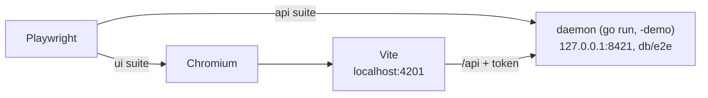
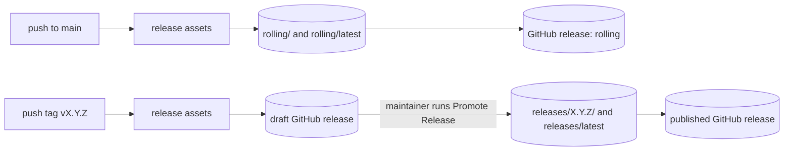

# Developer guide

How to build, run, test and release HomeShell. What the parts are and how they fit together is
in [ARCHITECTURE.md](ARCHITECTURE.md); domain terms are in [CONTEXT.md](../CONTEXT.md).

Every entry point is a Makefile target. `make help` lists them.

## Toolchain

| Tool | Version | Source of truth |
|---|---|---|
| Go | pinned per module; Go 1.21+ fetches it | `go.mod` in `daemon` and `desktop` |
| Node.js | 24+ | `engines` in `webapp/package.json` |
| pnpm | 11+ | `engines` and `packageManager` in `webapp/package.json` |
| WebKitGTK dev files | 4.1 (Linux, desktop shell only) | `make check-webview` |
| debhelper, rpm | packaging only | `debian/control`, `packaging/rpm/homeshell.spec` |

- Two Go modules: `daemon` and `desktop`. Each has its own `go.mod`; CI fails when
  `go mod tidy` would change either.
- The web app is an Nx workspace under `webapp/` (pnpm workspaces): `apps/web`, `apps/web-e2e`,
  `packages/model`, `packages/components`. Vite builds and serves it, vitest unit-tests it,
  Playwright drives the e2e suites, ESLint and `tsc` check it.

## Setup

```sh
make setup   # Go modules, pnpm workspace, Playwright's Chromium
```

- `make check-tools` (run by `setup`) reports every missing tool at once.
- For the desktop shell on Linux, install the webview dev files:
  `sudo apt-get install libwebkit2gtk-4.1-dev` (Fedora: `webkit2gtk4.1-devel`).
- **Log out and back in after any apt operation on `libwebkit2gtk-*`**, removals included.
  Why: WebKitGTK apps started in a session that predates the change open a window that never
  maps, and running ones hang. A plain GTK window (`zenity --info --text=test`) still works.
- A package missing a file after an interrupted install survives `pnpm install`, which reports
  "Already up to date". Fix it with `rm -rf webapp/node_modules && make setup`.

## Build

| Target | Produces |
|---|---|
| `make build` | Web app, embedded into `bin/homeshell` |
| `make build-webapp` | `webapp/apps/web/dist` |
| `make embed` | Copies the web build into `daemon/internal/webui/dist` |
| `make build-daemon` | `bin/homeshell` (runs `embed`) |
| `make build-desktop` | `bin/homeshell-desktop` (CGO and a system webview) |
| `make archive` | `dist/homeshell-<os>-<arch>.tar.gz`, the standalone daemon |
| `make deb`, `make rpm` | The Linux package in `dist/` (`deb-quick` skips the Build-Depends check) |
| `make dmg` | `dist/HomeShell-<version>-<arch>.dmg` (macOS only) |
| `make clean` | Removes `bin/`, `dist/`, the web build and the embedded copy |

- `VERSION` comes from `scripts/version.sh`: the release tag on a tagged commit, otherwise
  `git describe` against the latest release tag (`0.0.0-g<sha>` before the first one).
  `PACKAGE_VERSION` is its deb/rpm form, where snapshots sort between releases.
- `homeshell` also links `COMMIT` and `BUILD_CHANNEL`. Only `make archive` with
  `BUILD_CHANNEL=rolling` or `stable` produces a binary that updates itself
  ([Self-update](ARCHITECTURE.md#self-update)).
- The packaging targets embed the web build that exists; run `make build-webapp` first.
- The session bridge is `bin/homeshell` itself, run as `homeshell bridge serve`, so there is no
  separate bridge binary ([Session bridge](ARCHITECTURE.md#session-bridge)).
- `homeshell` is built with `CGO_ENABLED=0`; CGO is confined to the `desktop` module
  ([Desktop shell](ARCHITECTURE.md#desktop-shell)).

### Desktop shell

- `webview_go` asks pkg-config for `webkit2gtk-4.0`, which Ubuntu dropped in 24.04.
  `packaging/linux/pkgconfig/` answers that request from 4.1. Why that is sound: 4.1 is the same
  C API, built against libsoup3.
- `make build-desktop` uses the shim whenever 4.1 is installed, and a system 4.0 only when 4.1
  is missing. Why: a dev build then links what a release links.
- It then runs `check-desktop-linkage`, which fails unless the binary links
  `libwebkit2gtk-4.1`. Why: the Go build cache ignores `PKG_CONFIG_PATH`, so a cached object can
  silently link the other version. The fix it suggests is `go clean -cache`.
- macOS (WKWebView) needs no extra dev package.

## Run

| Target | Runs |
|---|---|
| `make run` | `make build`, then `bin/homeshell serve` at debug level on `127.0.0.1:8420` |
| `make run-local` | Same, with all data in `db/<branch>` (gitignored) |
| `make dev` | Daemon via `go run` and the Vite dev server (`http://localhost:4200`) side by side |
| `make dev-local` | Same, with data in `db/<branch>` |
| `make dev-demo` | Same, with `serve -demo` (fake provider, seeded workstreams) |
| `make dev-daemon`, `make dev-webapp` | One half of `make dev` |
| `make run-desktop` | Builds everything and opens the desktop window |
| `make run-desktop-local` | Same, attached to the `make run-local` daemon |
| `make dev-update` | The self-update flow against a fake release server |

- `DAEMON_ARGS` passes extra `serve` flags, e.g. `make run DAEMON_ARGS=-log-level=verbose`.
  Flags are in [CONFIGURATION.md](CONFIGURATION.md#command-line-flags).
- `make run-desktop` alone uses the platform data directory on `:8420`, so next to a
  `make run-local` daemon it collides rather than attaches. Use `make run-desktop-local`.
- The desktop targets pass `HOMESHELL_HOME_DIR` and `HOMESHELL_ADDR` to the shell.
- `make dev-webapp` runs Vite directly, not `nx dev`. Why: Nx puts the shared terminal in raw
  mode, so Ctrl-C stops reaching the `make -j2` group, and it leaks the detached Vite process.

### Dev server and token

In dev, Vite serves the UI and proxies `/api` to the daemon (`webapp/apps/web/vite.config.mts`).
The daemon never sets its auth cookie there, so the proxy adds the token as a Bearer header.

| Variable | Read by | Effect |
|---|---|---|
| `HOMESHELL_DAEMON_URL` | Vite, Playwright | Daemon the proxy targets; Vite defaults to `http://127.0.0.1:8420` |
| `HOMESHELL_WEB_URL` | Playwright | Dev server the UI suite opens; default `http://localhost:4201` |
| `HOMESHELL_API_TOKEN` | Vite, Playwright, daemon | Token the daemon pins and the proxy and e2e specs send |

- The `dev*` targets pin `HOMESHELL_API_TOKEN` to `homeshell-dev-token` unless it is set to a
  non-empty value. An empty or whitespace-only value counts as unset everywhere.
- Without a token Vite warns at startup and every proxied request gets a `401`.

### Calling the API by hand

Every `/api` request needs the token. Read it and the address from the discovery file
`daemon.json` in the daemon's data directory:

```sh
state="${XDG_DATA_HOME:-$HOME/.local/share}/homeshell/daemon.json"   # Linux default
addr=$(jq -r .address "$state")
curl -s -H "Authorization: Bearer $(jq -r .token "$state")" "http://$addr/api/projects"
```

- For `make run-local` the file is `db/<branch>/daemon.json`; for the shared e2e daemon,
  `db/e2e/daemon.json`. Other locations are in [CONFIGURATION.md](CONFIGURATION.md#data-directory).
- A generated token rotates on every start, including the restart `homeshell update` performs,
  so re-read it rather than exporting it once. CLI verbs such as `homeshell status` need none of
  this: they read the discovery file themselves.
- Endpoints and auth rules are in [API.md](API.md).

### Self-update

`make dev-update` builds `bin/homeshell` at `CURRENT_VERSION` (`0.0.1`), a "new" binary at
`UPDATE_VERSION` (`0.0.2`), then runs `scripts/fake-release-server.sh` on `UPDATE_PORT`
(`9876`), the daemon pointed at it with `HOMESHELL_UPDATE_BASE_URL`, and Vite. The fake server
serves the stable channel's layout ([Self-update](ARCHITECTURE.md#self-update)).

- Both binaries are stamped `BUILD_CHANNEL=stable`. Why: a build without a channel never updates
  itself, and the installed one should be able to update again.
- The current version is pinned. Why: on a tagged checkout `scripts/version.sh` is above
  `0.0.2`, and the updater would find nothing newer.
- The parallel stage runs with `PREBUILT=1` and builds nothing. Why: two concurrent `embed` runs
  `rm -rf` the embed directory while a `go build` reads it.

## Test

What to test and at which level is in [AGENTS.md](../AGENTS.md#testing-requirements).

`make test` runs, in order:

1. `test-docs-lint`: the docs lint's own tests (`scripts/docs-lint/lint.test.sh`).
2. `check-dev-targets`: see [Dev-target gate](#dev-target-gate).
3. `go test -tags=dev ./...` in `daemon`. The bridge integration test (`sbridge/bridgecli`) runs
   the real `bridge serve`, with the test binary itself as the bridge.
4. `go test ./internal/...` in `desktop`, which needs no webview.
5. `pnpm nx run-many -t test` in `webapp`: vitest for every project.

Single tests:

```sh
cd daemon && go test -tags=dev ./internal/store -run TestName
cd webapp && pnpm nx test @homeshell/web -- src/app/offline-reason.spec.ts
cd webapp/apps/web-e2e && pnpm exec playwright test src/api/logs.spec.ts
```

- `-tags=dev` includes daemon tests that plain `go test` skips; always pass it.
- A daemon test that runs `serve` must isolate both the discovery file and the data directory
  (`t.Setenv("XDG_DATA_HOME", t.TempDir())`). Why: otherwise it loads the developer's real
  projects, and startup on a machine with many of them blows the test's deadline.
- vitest has no `jest-dom` matchers; assert on DOM properties (`.checked`, `.disabled`).
- ESLint bans bare `location` and `history`; write `window.location`.

### End-to-end

`make test-e2e` runs both Playwright suites (`webapp/apps/web-e2e/playwright.config.ts`):

- `api`: black-box HTTP against the daemon, no browser.
- `ui`: Chromium against Vite, which proxies to the daemon as in `make dev`.

Playwright starts both servers itself:



- The daemon runs with `-demo` from a freshly wiped `db/e2e`, with a pre-seeded `settings.json`
  that turns notifications off. Its environment points the update server at nothing, turns the
  native folder dialog off and slows fake session starts
  ([test variables](CONFIGURATION.md#for-tests)).
- The token is `e2e-fixed-api-token` unless `HOMESHELL_API_TOKEN` is set.
- Some specs start a daemon of their own on an ephemeral port: `src/isolated-daemon.ts` for
  restarts, `src/enclave-helpers.ts` for Enclave sessions. The latter replaces the `enclave`
  CLI with a fixture script that keeps its state in the directory `HOMESHELL_ENCLAVE_FIXTURE`
  names, so no Docker is needed.
- With `CI` set, Playwright never reuses a running server, forbids `test.only` and retries
  failures twice.

Writing e2e specs:

- All specs share one daemon and run in parallel. Don't reset global state (settings, log
  level) in hooks; assert per-request contracts and leave persistence to Go unit tests.
- A raw `fetch` uses the `baseURL` fixture. Why: `HOMESHELL_DAEMON_URL` is not set in the test
  process, so a local fallback constant points at the wrong port.

When e2e fails strangely:

- **Unrelated failures after a daemon change:** outside CI Playwright reuses a server already
  listening, and a `go run` child can outlive its parent. Check
  `lsof -iTCP:8421 -sTCP:LISTEN` and kill the stale process.
- **Many UI timeouts with an empty page:** check `df -h /tmp`. Chromium profiles go there, and
  through Nx a full disk shows up only as timeouts. Run one spec with `playwright test` to see the
  real error.

### Dev-target gate

`check-dev-targets` (part of `make test`) dry-runs every `dev*` target and checks that:

- each parses and has a recipe;
- `HOMESHELL_API_TOKEN` reaches a dev recipe's environment non-empty (via `print-dev-token`);
- `make dev-update` wipes the embed directory exactly once.

Why: no other test runs these targets, and CI never does. A `.PHONY` target with no recipe exits
`0`, and the e2e suite pins its own token, so a broken `make dev` would otherwise stay green.

## Lint

`make lint` runs:

1. `docs-lint` (`scripts/docs-lint/lint.sh`): Markdown lines over 120 characters, relative
   Markdown links to files that don't exist, and references to missing `docs/*.md` files in code
   comments. The script's header lists the exemptions.
2. `gofmt -l` on `daemon/` and `desktop/`; `make fmt` fixes it.
3. `go vet -tags=dev ./...` in `daemon`, `go vet ./internal/...` in `desktop`.
4. `pnpm nx run-many -t lint typecheck` in `webapp`.

## Docs

The rules for which doc a change updates, and how to write it, are in
[AGENTS.md](../AGENTS.md#documentation). The index is [README.md](README.md).

- The PR template (`.github/pull_request_template.md`) asks for tests, docs and changelog.

## CI

`.github/workflows/ci.yml` runs on every pull request and on pushes to `main`. A new push to a
pull request cancels its running checks.

| Job | Runs |
|---|---|
| Docs lint and release scripts | `docs-lint` and its tests, `scripts/release.test.sh` |
| Daemon | `go mod tidy` check, `go vet`, `go test -tags=dev`, cross-compile |
| Desktop shell | `go mod tidy` check, vet and test `./internal/...`, `make build-desktop` |
| Webapp | `nx run-many -t lint typecheck test`, production build |
| Binary build & e2e | `make build`, `make test-e2e`; uploads Playwright output on failure |

- CI calls the steps directly rather than `make test` or `make lint`. A step added to one of
  those targets must be added to `ci.yml` too.
- The daemon job cross-compiles for macOS. Why: every CI job runs on Ubuntu while releases also
  build on macOS, so a Linux-only syscall would break only in the release build.
- `release-assets-smoke.yml` builds every release artifact for a pull request that touches
  packaging (`Makefile`, `debian/`, `packaging/`, the asset workflow, `go.mod`). It publishes
  nothing.
- Workflows pin every action to a full commit SHA, with its release tag in a comment. Why: a tag
  can be moved to other code, and the release jobs hold a token that can write releases.

## Releases

Two channels, both published to [download.eclipse.org/enclave/homeshell][downloads] and to GitHub
releases:

- **rolling**: every push to `main` replaces `rolling/` and the `rolling` GitHub pre-release.
- **stable**: a `vX.Y.Z` tag, or `vX.Y.Z-alpha.N`, `-beta.N`, `-rc.N` for a pre-release, goes to
  `releases/<version>/` after a maintainer promotes it.



| Workflow | Does |
|---|---|
| `reusable-release-assets.yml` | Builds every artifact once into one `release-assets` artifact |
| `rolling.yml` | Publishes a `main` build to `rolling/`, then recreates the `rolling` release |
| `release.yml` | On a release tag: builds and attaches the assets to a draft release |
| `promote-release.yml` | Manual: publishes a reviewed draft to `releases/<version>/`, then on GitHub |

A release contains:

| File | Built by | Updates itself |
|---|---|---|
| `homeshell-{linux,darwin}-{amd64,arm64}.tar.gz` | `make archive`, channel-stamped | yes |
| `homeshell_<pkg-version>-1_amd64.deb` | `make deb-quick` on Ubuntu 24.04 | no |
| `homeshell-<pkg-version>-1.<dist>.x86_64.rpm` | `make rpm` on Fedora | no |
| `HomeShell-<version>-{arm64,amd64}.dmg` | `make dmg` on macOS | no |
| `checksums.txt` | SHA-256 of every file above | |

- The self-updater reads `rolling/latest` (a commit) or `releases/latest` (a version) and the
  files beside it ([Self-update](ARCHITECTURE.md#self-update)). Packages and the macOS app
  carry no channel and are updated by installing a newer one.
- Assets are built once. Promote Release checks the draft's files against the tag build's own
  artifact and the `homeshell-release` marker in the draft notes, then publishes those bytes.
  Why: a release must be exactly what was reviewed, with no rebuild in between.
- A release directory is immutable and `releases/latest` only moves forward. Pre-releases are
  published but never become latest.
- Package names have `~` replaced (`scripts/github-asset-name.sh`) before `checksums.txt` is
  written. Why: GitHub renames assets on upload, and both download locations must agree.
- There is no native Windows build and the Go code has no Windows code paths: Windows users run
  the Linux build in WSL. Why: the session bridge and Enclave are Unix-only.
- Linux packages are amd64 only, because CI builds `homeshell-desktop` for amd64 only. arm64
  users use the daemon archive and a browser.
- The `.deb` takes its WebKitGTK dependency from the binary (`dpkg-shlibdeps`); the `.rpm` names
  `webkit2gtk4.1` and gets the sonames from the binary too.
- Archives, Linux packages and macOS app bundles include `LICENSE`, `NOTICE.md`,
  `THIRD-PARTY-NOTICES.txt` and the Herdr license under `licenses/herdr/LICENSE`. Linux packages
  install these under `/usr/share/doc/homeshell`; macOS apps use `Contents/Resources`.
- macOS artifacts are unsigned, so Gatekeeper blocks the first open (`TODO(signing)` in
  `packaging/macos/build-app.sh`).
- The macOS app targets macOS 12 (`MACOSX_DEPLOYMENT_TARGET` on the `dmg` target), the oldest
  release Go supports, and `build-app.sh` fails if a binary targets another. Why: without it cgo
  links for the runner's SDK, and the app refuses older systems.
- Publishing uses the `SCP_USERNAME`, `SCP_KEY` and `SCP_PASSPHRASE` organization secrets for
  `projects-storage.eclipse.org` (Otterdog). Forks build but never publish.

[downloads]: https://download.eclipse.org/enclave/homeshell/

### Changelog notes

PRs do not edit `CHANGELOG.md`, except the release-prep PR. Why: the PR number is unknown until
the PR is open, and every open PR with an entry conflicts with every other on merge.

A PR describes its user-visible changes in the `changelog` block of its description, which the
PR template provides:

- One `- ` item per change, in the user's terms, wrapped lines indented by two spaces.
- A breaking change starts with `Breaking:` and says what to do instead.
- No PR or issue link: release prep adds it.
- `none` inside the block when users will not notice the change.
- The note can be corrected in the description until the release, without a commit.

```changelog
- Docs rebuilt from the code: a docs index, architecture, API, providers, configuration and
  developer guides, and a glossary.
```

Before tagging, a release-prep PR collects the notes of the PRs merged since the last tag, plus
any items still under `## Unreleased`, into `## X.Y.Z - YYYY-MM-DD` at the top of
`CHANGELOG.md`:

- Each item ends with a link to its PR.
- `Breaking:` items go under `### Breaking changes` in that section.
- Release prep may merge, reword or drop notes, e.g. when a later PR changes the same behavior or
  a PR was reverted.
- Last fixes go in the same PR, so the tagged source describes the release it belongs to.

The draft GitHub release's notes come from `scripts/release-notes.sh` (commit, downloads,
install instructions). Paste the release's `CHANGELOG.md` section into the draft before promoting
it, above the `homeshell-release` marker, which must stay.

### Testing a release locally

The release builds run on `main`, on tags, and on pull requests that touch packaging, so most
pull requests never exercise them.

- `make archive BUILD_CHANNEL=rolling` builds a self-updating archive for this machine;
  `GOOS`/`GOARCH` pick another platform.
- `make deb-quick` needs `debhelper` and `libwebkit2gtk-4.1-dev`; `make rpm` needs `rpm`, and
  builds more faithfully in a `fedora` container, where the release RPM is built.
- Both package builds read a source tarball of the checkout (tracked and untracked files, plus
  the embedded web UI), not the working tree, and pass `VERSION` and `COMMIT` in.
- `bash scripts/release.test.sh` (part of `make test`) checks version derivation, asset naming
  and the manifest check against throwaway repositories.

### Shipping a new binary

A binary in `make build` is not yet in any artifact. Add it to every path that assembles one:

- `debian/rules` and `packaging/rpm/homeshell.spec`, plus `scripts/verify-package.sh`.
- The `dmg` target in the `Makefile` and `packaging/macos/build-app.sh`.
- The `archive` target, if it belongs in the standalone daemon archive.

Self-update replaces only the running `homeshell`, so a second binary keeps its installed
version.
