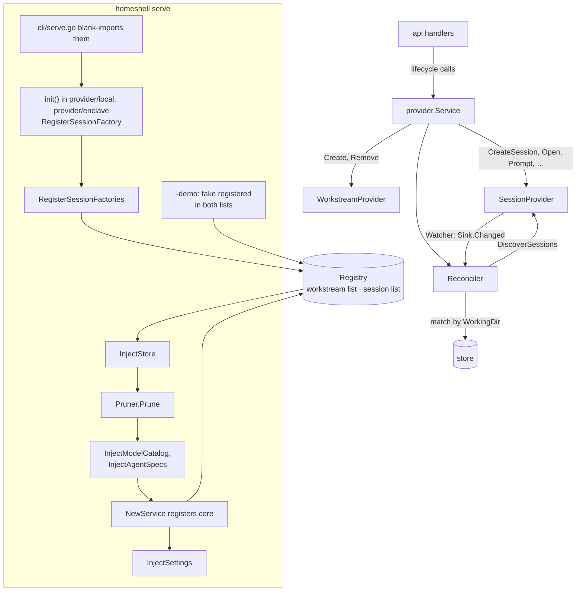

# Providers

The provider model, the providers that exist, and how to add one. Terms (workstream provider,
session provider, capability, session option, …) are defined in
[CONTEXT.md](../CONTEXT.md#providers). How the daemon matches and retains sessions is in
[ARCHITECTURE.md](ARCHITECTURE.md#providers-and-reconciliation); the HTTP surface is in
[API.md](API.md#providers).

## The two contracts

Both live in `daemon/internal/provider` (`provider.go`). The two kinds of provider never call each
other; they meet only at `domain.Workstream.WorkingDir`.

**`WorkstreamProvider`** owns a workstream's record and directory.

| Method | Does |
|---|---|
| `ID`, `Label` | Opaque ID stamped onto the workstream; name shown in the create pick-list |
| `Available` | Whether it can create at all right now |
| `CanCreate` | Whether it can create on this project. The provider decides, never a client |
| `Schema` | JSON Schema of the create form, possibly specialized to the project |
| `Create` | Materializes the directory; returns `Name`, `Strategy`, `Branch`, `WorkingDir`, `CreatorData` |
| `Remove` | Discards the directory unless `KeepFiles`; sessions are already gone |

- The daemon assigns the workstream ID and stamps `Provider`; the provider must not.
- `CreatorData` is the provider's private teardown data. No one else reads it.
- Renaming is store data, so it is not on the contract.

**`SessionProvider`** owns sessions and their live state.

| Method | Does |
|---|---|
| `ID`, `Label` | Opaque ID stamped onto each session it owns; name shown in the new-session form |
| `Available` | Whether its backend is usable. If not, it contributes no sessions and refuses lifecycle calls |
| `Capabilities` | The data-only capabilities (see [Capabilities](#capabilities)) |
| `SessionSchemas` | The session options it offers in a workstream, each with a JSON Schema |
| `CreateSession` | Launches in `req.WorkingDir`; the daemon stamps `Provider` |
| `RemoveSession` | Tears the runtime down, in any state |
| `SessionState` | One session's current state |
| `Open` | How a client opens a session in one of its open modes |
| `DiscoverSessions` | Every session it observes for a project, each tagged with its working directory |

- Why `DiscoverSessions` and not "list workstreams": a session provider never needs to know which
  workstream a directory belongs to, or read another provider's private data to find out.
- `CreateSessionRequest.Progress` takes startup output one line at a time, from any goroutine.
  It is never nil.

## Capabilities

Capabilities are what clients gate on. Two kinds:

- **Data-only**, returned by `Capabilities()`: `OpenModes`, `MaxConcurrentSessions` (0 is
  unlimited; the daemon enforces it on create, start and restart), `DetectsWaiting`.
- **Behavioral**, an optional interface found by type assertion. `Registry.DescribeSession` turns
  some into flags on `GET /api/providers`. A provider declares a behavior by implementing it,
  never by setting a flag.

| Interface | Role | Adds |
|---|---|---|
| `Prompter` | Session | `Prompt` and `SendKey`; served as `oneOffPrompt` |
| `SessionStartStopper` | Session | Stop and start; `sessionStartStop`. Start may be a restart (`ErrStartIsRestart`) |
| `SessionRestarter` | Session | Restart with new settings (`PrepareRestart`); served as `sessionRestart` |
| `ContinueRefuser` | Session | Refuses to continue a conversation another session in the directory makes ambiguous |
| `OptionSchemaProvider` | Session | One option's schema without listing them all |
| `ShellOpener` | Session | A shell inside the session's environment, offered as an extra open mode |
| `LinkOpener` | Session | Browser links, offered as `link:<id>` open modes |
| `Watcher` | Session | Pushes change notifications (see [Wiring](#wiring)) |
| `WatchedDiscoverer` | Session | Serves change-driven passes from what its watcher already captured |
| `Pruner` | Session | Drops sessions of removed projects, once at startup |
| `ConfigValidator` | Workstream | Checks a create synchronously, before anything is reserved |
| `ValidationSchemer` | Workstream | A cheaper schema to validate against than the form's |
| `DraftResolver` | Workstream | Names and fills what a blank create would derive |
| `StrategyTeller` | Workstream | A create's strategy, for its placeholder to carry |
| `Refresher` | Workstream | Brings a workstream up to date on each projection, e.g. its branch |
| `FolderSurveyor` | Workstream | Lists folders; says which are untracked and which workstreams lost theirs |
| `WorkstreamStartStopper` | Workstream | Only the fake has it and the daemon never calls it; `startStop` is false |

- Why `ConfigValidator`: JSON Schema cannot state git's branch-name rules, and a rule checked in
  the asynchronous `Create` would surface minutes later as an `error` workstream instead of a `400`.

## Wiring

- **Registration.** A session provider package calls `provider.RegisterSessionFactory` from
  `init()`; `daemon/internal/cli/serve.go` blank-imports it, and `RegisterSessionFactories`
  builds every factory into the registry. A factory returns `(nil, nil)` to decline; an error
  aborts startup. Why: adding a provider is a package plus an import, as for API endpoints and CLI
  verbs.
- **Demo mode** registers no factories: the fake plays both roles, registered directly.
- **Core** is registered by `provider.NewService` if the registry has no `core` yet.
- **Injection.** Factories run before the store, agent catalog and settings exist, so those
  arrive later through `StoreAware`, `ModelCatalogAware`, `AgentSpecAware` and `SettingsAware`
  (`registry.go`). Embedding `provider.SettingsHolder` satisfies `SettingsAware` and supplies the
  refresh interval and terminal preference. Why one catalog for all: an agent must offer the
  same settings and models whether it runs on the host or in a container.
- **Refresh.** `Reconciler.Run` starts each `Watcher` in its own goroutine. A watcher typically
  polls with `provider.WatchLoop`, which re-reads the configured refresh interval each period,
  and calls `Sink.Changed` only when something changed. The reconciler then re-asks just that
  provider. The reconciler's own periodic poll is off (`NewService(…, 0)`).
- **Lifecycle routing.** `provider.Service` owns every mutation. It routes each call to the
  session's owning provider (`Session.Provider`) or the workstream's (`Workstream.Provider`),
  answers `ErrCapabilityUnsupported` for a missing capability, and runs creates and restarts in
  the background (see [Workstream lifecycle](ARCHITECTURE.md#workstream-lifecycle)).
- **Removing a workstream** removes its sessions through their providers before the workstream
  provider's `Remove` ([Workstream lifecycle](ARCHITECTURE.md#workstream-lifecycle)).

## Existing providers

| ID | Label | Role | Package | Registered |
|---|---|---|---|---|
| `core` | Default | Workstream | `provider` (`core.go`) | Always, by `NewService` |
| `local` | Local System | Session | `provider/local` | Factory, outside demo mode |
| `enclave` | Eclipse Enclave | Session | `provider/enclave` | Factory, outside demo mode |
| `fake` | Fake Provider | Both | `provider/fake` | `serve -demo` only |

Session-provider capabilities:

| | `local` | `enclave` | `fake` |
|---|---|---|---|
| Open modes | `terminal` | `terminal`, plus a container shell | `terminal`, shell, links |
| Max concurrent sessions | unlimited | unlimited | 3 in the demo |
| Detects waiting | ✓ | | |
| Prompt and keys | ✓ | ✓ | ✓ |
| Stop and start | ✓ | ✓ (start is a restart) | ✓ |
| Restart with new settings | | ✓ | ✓ |
| Watcher | ✓ | ✓ | ✓ |
| Prunes at startup | ✓ | | |

### Core

The one production workstream provider. It prepares a directory with one of the filesystem
strategies ([CONTEXT.md](../CONTEXT.md#working-directory)) through `provider/workstream`
(`Prepare`, `Discard`).

- **Default strategy:** `worktree` in a git-backed project, else `in-place` (the schema's
  default, also for a config naming none) or, in the form once a workstream holds the project
  folder, `copy` (see [API.md](API.md#workstreams)).
- **Default workstream:** `provider.Service.AddProject` creates one `in-place` workstream with
  every new project, synchronously (nothing to materialize). Sessions already running in the
  project folder attach in a projection pass after the request, as it asks every session provider.
- **Branch follows checkouts.** A workstream's branch is the one checked out in its folder; an
  `in-place` workstream is named after it when given no name. A `copy`, made without `.git`, has
  none. Core is a `Refresher`: each projection re-reads that branch from a HEAD file, without
  running git (in place `git.EnclosingHeadBranch`, the nearest repository at or above the project
  folder; elsewhere `git.HeadBranch`, the folder's own. Why: it runs for every workstream on each
  tick, and must not find a repository above a copy), and a watch loop at the
  refresh interval re-projects when it moved, as nothing else notices a switch with no session
  running. Only an `in-place` workstream's name follows the branch, while it is still the one the
  core gave (`coreCreatorData.GivenName`: the branch, or the folder's or a numbered name where the
  branch was missing or taken) and no other workstream in the project has it; a renamed
  workstream keeps its name. A detached HEAD clears the branch and keeps the name.
- **Untracked worktrees.** Core is a `FolderSurveyor`: one `git worktree list` per project per
  refresh (bounded to 500 ms–1 s; an Add's own listing to 5 s, as a user waits on it). Every entry
  but git's first, the main worktree, whose folder is there and that no project or workstream
  holds, nor a create in flight, is suggested, named after its branch or, detached, its folder. A
  create holds its folder until its workstream is stored (`CreateRequest.HoldClaim`), so a pass in
  between does not suggest it. A listing without even the main worktree counts as failed
  (`git.LinkedWorktrees`), so it vanishes nothing. A `worktree` workstream vanishes once its folder
  is unlisted or deleted. A folder only out of reach (git keeps it registered, e.g. on an unmounted
  drive) is not suggested, and its workstream stays. Adding a suggestion (`TrackFolder`) creates
  nothing on disk and makes a `worktree` workstream like a created one, its name numbered past
  those taken (`name-2`, …).
- Removing an `in-place` workstream never deletes the project directory; `worktree` needs a
  git-backed project.
- Managed worktree and copy directories go under the `workstreams.location` setting, read live,
  or the default root in the data directory.
- Its form suggests git refs (bounded to 2 s); `ValidateCreate` rejects bad branch names and
  directories another workstream works in, with field-level errors; `ResolveDraft` derives the
  name, branch and path.

### Local System

Runs each agent as a host process under a session bridge
([Local System sessions](ARCHITECTURE.md#local-system-sessions)).

- **Options:** one per agent in the agent catalog whose CLI is on `PATH`; the schema is built
  from that agent's settings rows (`agentspec.Schema`).
- **Available** when the [session bridge](ARCHITECTURE.md#session-bridge) can run and at least
  one catalog agent's CLI is on `PATH` (`hostbridge` `Runtime.Available`).
- **State, title and preview** come from `detect` over the bridge's screen
  ([Agent detection](ARCHITECTURE.md#agent-detection)).
- **Start** relaunches the agent, continuing its conversation when the agent can resume one.
- Re-attaches to running bridges after a daemon restart.

### Eclipse Enclave

Runs each agent in an Enclave container, driven only through the `enclave` CLI
([Enclave sessions](ARCHITECTURE.md#enclave-sessions)). Why never Docker directly: the
container is Enclave's to manage.

- **Options:** one per Enclave tool profile (`enclave tools`), falling back to `claude`.
- **Available** when `enclave` is on `PATH` and meets the provider's CLI contract, and the
  session bridge can run (as for [Local System](#local-system)).
- `OpenShell` opens a shell inside the container.
- **Start** of a stopped, done or error session is an `enclave continue`, run by the service as a
  restart.
- **CLI gaps** that limit it are in `provider/enclave/gaps.go`: no container event stream, `stop`
  also removes, no `start`, no published-port URL (so no web-IDE link), no `logs`.

### Fake

An in-memory provider for `serve -demo` and the e2e suites. It owns the seeded demo sessions,
cycles one through states, and implements most optional interfaces so each UI path has data.

## Add a session provider

1. Create `daemon/internal/provider/<name>` with a type implementing `provider.SessionProvider`.
   - `Available` returns `false` and a reason when the backend is missing; never fail startup.
   - `CreateSession` launches in `req.WorkingDir`, which the daemon hands it.
   - `DiscoverSessions` tags every session with the directory it runs in.
   - `RemoveSession` succeeds in any state. Why: confirming a removal is a client concern.
2. Implement only the optional interfaces you support (see [Capabilities](#capabilities)). Add a
   compile-time assertion for each, `var _ provider.Prompter = (*Provider)(nil)`. Why:
   capabilities are found by type assertion, so a grown interface would otherwise silently drop
   the capability.
3. If sessions change on their own, implement `Watcher` with `provider.WatchLoop` and embed
   `provider.SettingsHolder` for the interval. Without it, state refreshes only on startup and
   lifecycle calls.
4. Keep slow backend calls outside your provider's lock and bounded by a timeout. Why: a hung
   backend must not block creates, opens or a reconcile pass.
5. Register from `init()` with `provider.RegisterSessionFactory` and blank-import the package in
   `daemon/internal/cli/serve.go`.
6. If it persists data, add its file to [Persistence](ARCHITECTURE.md#persistence).
7. Test both levels: table-driven Go tests in the package, and an e2e API test in
   `webapp/apps/web-e2e/src/api`. A real backend is faked by a CLI on `PATH` in an isolated
   daemon (`enclave-cli.fixture.cjs`, `src/enclave-helpers.ts`).
8. Add it to [Existing providers](#existing-providers).

## Add a workstream provider

1. Implement `provider.WorkstreamProvider`. `Create` sets the public `WorkingDir` and keeps
   teardown data in `CreatorData`.
2. The daemon validates a create's config against `Schema` (or `ValidationSchema`) before
   calling `Create`; implement `ConfigValidator` for rules a schema cannot state.
3. Register it with `Registry.RegisterWorkstreamProvider` in `serve.go`; there is no workstream
   factory.
4. Test and document it as in [Add a session provider](#add-a-session-provider).
